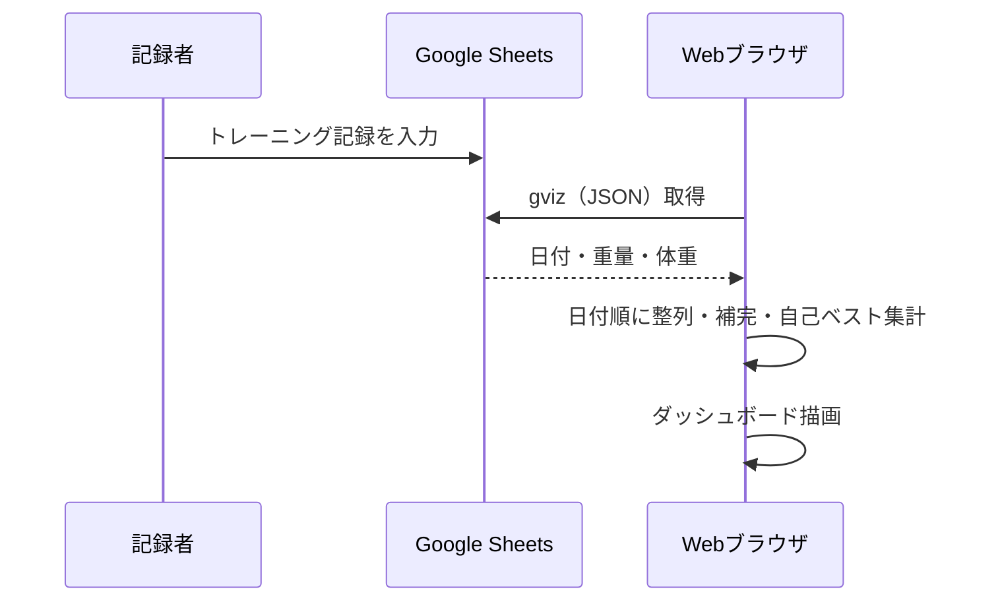

# 画面・データ仕様

## 概要

BIG3 Recordは、ベンチプレス・スクワット・デッドリフト・体重の履歴をGoogle Sheetsから取得して表示する読み取り専用のダッシュボードです。

## スプレッドシート

| 列 | 内容 | 単位・例 |
| --- | --- | --- |
| A | 日付（timestamp） | UNIX秒、ISO形式、YYYY/MM/DDなど |
| B | BP | kg（例: 115） |
| C | SQ | kg（例: 120） |
| D | DL | kg（例: 170） |
| E | Body Weight | kg（例: 86） |

1行目はヘッダーです。gvizは通常、シートのヘッダー行を列情報として解釈するため、レスポンスのデータ行は**先頭から使用**します。もしデータ中に明示的なヘッダー行があれば除きます。空欄・非数値の重量は`null`、不正な日付の行はグラフ・集計から除外します。日付はブラウザの日時解釈に従い、UNIX秒・ミリ秒・文字列・gvizの`Date(...)`に対応します。

シートIDは`src/sheetApi.ts`の`SPREADSHEET_ID`です。ブラウザからgvizエンドポイントを直接呼び出すため、閲覧者が読み取れる公開設定が必要です。変更権限は不要です。

## 集計ルール

- **BP/SQ/DLの自己ベスト**：有効な全記録中で各種目の最大重量。
- **BIG3 Total（自己ベスト）**：各種目の最大重量の**合計**です。同じ日に3種目を挙げた実績値とは限りません。
- **最新の体重**：日時が最も新しい有効記録まで遡って、最後に記録された正の体重。
- **自己ベスト体重比**：自己ベスト重量 ÷ 最新の体重（小数第2位まで）。
- **時系列グラフ**：日付昇順で、各種目と体重の欠損をそれぞれ直前に記録された正の値で補完します。最初の記録以前は補完せずnullとします。
- **時系列Total**：その時点で有効なBP・SQ・DLの値が全て揃った場合に合計します。
- **時系列体重比**：各時点で有効だった体重を分母とします。体重が未記録の場合は倍率を表示しません。

したがって、自己ベストのTotalと、グラフ中のTotalの最大値は一致しない場合があります。いずれも有効な種目値を基に算出します。

## 画面

- **自己ベスト**：BP、SQ、DL、Totalの4カードを表示。kg/体重比を切り替えます。
- **記録サマリー**：最新の体重、および3種目の自己ベストがTotalに占める割合。
- **履歴グラフ**：Total、BP、SQ、DL、体重の5グラフ。体重グラフは単位切り替えの対象外です。
- **期間選択**：6か月 / 1年 / 全期間（初期値）。期間の起点は**最終記録日**であり、現在の日付ではありません。追加通信せずフィルターします。
- **取得状態**：初回ローディング・データなし・取得失敗を表示し、失敗時には再試行ボタンを出します。
- **更新**：画面表示時に1度読み取ります。通常の自動ポーリングはありません。新しい記録はページの再読み込みで反映されます。

## レスポンシブ・アクセシビリティ

PCでは数値カード4列・グラフ2列、小画面ではカード2列・グラフ1列に変わります。切り替えボタンには`aria-pressed`を付け、失敗表示には`role="alert"`を使用します。グラフはRechartsによる視覚表示で、全データを読み上げる表の提供は現状ありません。
